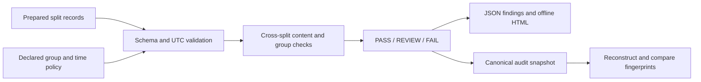

# SplitSentinel

A local dataset split-policy auditor for normalized content overlap, entity/source-group overlap, declared chronological windows and near-text review. It produces bounded finding reports, an offline HTML viewer and reproducible audit snapshots.

This is a data-validation tool for ML workflows, not a model-training project. Its original synthetic examples intentionally exercise known contamination scenarios. It does not establish model accuracy, complete leakage detection, semantic duplicate detection or production deployment.

## Run on Windows / Python 3.11

No external Python package, GPU, Docker, API key, network download or HTTP server is needed.

```powershell
cd "D:\AI-Projects\outputs\SplitSentinel"
py -3.11 -m venv .venv
.\.venv\Scripts\python.exe -B pipeline.py
Start-Process .\reports\report.html
```

The pipeline audits three 90-record authored scenarios and runs the actual tests. It expects clean=PASS, contaminated=FAIL, near_only=REVIEW. The contaminated fixture's FAIL is an expected audit finding, not a failed installation. The pipeline succeeds only when all authored scenario expectations, snapshot reconstructions and tests pass.

In the HTML viewer switch scenarios and inspect affected record IDs, group-value fingerprints and event-time/window evidence. Raw text is not embedded in the report. JSON reports contain the full structured findings up to the display cap. reports/RESULTS.md summarizes the measured scenarios; reports/verification.json records runtime and code fingerprints.

## Audit your own prepared input

Input is a JSON list with exactly these fields per record:

```json
{
  "row_id": "sample-001",
  "split": "train",
  "entity_id": "account-1",
  "source_group": "document-family-1",
  "event_at": "2025-01-03T00:00:00Z",
  "text": "Original example content"
}
```

The six-field adapter contract is intentional. Extra data columns must be projected out before auditing. Row IDs must be globally unique; group IDs may recur within a split. At most 500 records, 120 characters per ID and 2,000 characters per text are accepted. Timestamps must explicitly be UTC. Empty/missing text, unknown fields/splits, duplicated row IDs, invalid timestamps or invalid policies fail input validation rather than produce PASS.

private/policy.json contains the versioned policy generated by the demo. Declare group disjointness only when the assessment design requires it: recurring customers across a temporal forecast split can be legitimate. This tool checks supplied policy, not whether your study design is appropriate. Group IDs and timestamps are trusted supplied provenance; their real-world truth is not verified.

Time windows are start-inclusive/end-exclusive and must be ordered train→validation→test without overlapping. A record outside its assigned window is a policy violation. This is not a check of feature/label availability time; FeatureLedger handles that different problem. Temporal fields alone cannot prove absence of future information in other columns.

```powershell
.\.venv\Scripts\python.exe -B audit.py private/clean.json --policy private/policy.json --output private/my-clean-audit.json
.\.venv\Scripts\python.exe -B audit.py private/contaminated.json --policy private/policy.json --output private/my-contaminated-audit.json
```

Choose a new output filename for each run; existing outputs are not overwritten. Exit codes: 0 PASS, 1 FAIL (policy violation), 2 REVIEW (near-text matches only), 3 invalid input/output. A nonzero audit code is not automatically a Python crash. The pipeline handles its intentional failing/review scenarios independently.

## Detection scope

- NFKC, case-folding and whitespace normalization identify exact normalized text across splits. Shared content is a policy risk, not universal proof of harmful leakage.
- Group intersections use caller-declared entity_id/source_group boundaries. Findings retain affected row IDs and hash group values; they do not infer missing group provenance.
- Near-text comparison uses token-set Jaccard at the configured threshold (default .85). It ignores word order and frequency and can miss paraphrases or flag harmless templates. Matches require review and are never silently labelled confirmed leakage.
- Same-split duplicates are outside this cross-split check. Labels, near-image duplicates, preprocessing fitting, hidden feature availability, private upstream lineage and source authenticity are not audited.

Counts refer to findings, not distinct leaked records. One row may cause multiple findings. At most 1,000 findings are displayed while counters still include every checked finding; findings_truncated is explicit. The algorithm compares cross-split text pairs exactly and is bounded for a small local batch, not an approximate large-corpus service. No runtime/load benchmark is claimed.

## Snapshots

The pipeline freezes the canonical sorted input, policy and audit output under private/snapshots/<snapshot-id>. Identity includes input, policy, report and auditor-code fingerprints. Existing snapshots are verified and reused; input ordering alone does not create a new snapshot. Reconstruction uses stored inputs, checks file/content hashes and compares the logical report.

```powershell
.\.venv\Scripts\python.exe -B snapshot.py --verify YOUR_FULL_64_CHARACTER_SNAPSHOT_ID
```

Snapshot IDs appear in reports/verification.json. Changing source/policy/algorithm yields different identity. Old reports need the corresponding auditor/runtime behavior to reconstruct; cross-version equivalence is not assumed. Local manifests are unsigned and writable by the file owner, so hashes detect accidental changes but do not provide tamper-proof provenance or third-party attestation.

## Privacy and evidence

All committed reports should come only from the original fictional examples. Keep real inputs and their reports under private/. Reports retain row IDs and timestamps; group/text hashes can be linkable and are not anonymization. Do not publish sensitive audit inputs or findings. No external service receives data.

Tests exercise exact and near matches, explicit group policy, UTC and interval boundaries, malformed inputs, input order, truncation, immutable snapshot reuse, reconstruction and tampering. Passing these authored tests does not certify arbitrary datasets as leakage-free. The static viewer has no network/provider calls; browser layout is not automatically measured.



Code and original synthetic fixtures: MIT (LICENSE). No third-party dataset or trained model is redistributed.
